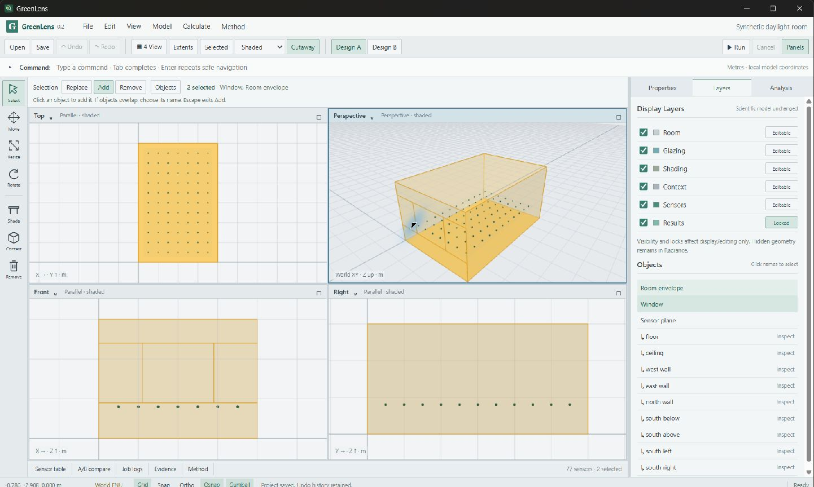

# GreenLens

Local-first building environmental simulation with Rust, a native Tauri desktop, Radiance and separately installed EnergyPlus.

The active v0.4 candidate adds a separate small-building thermal model, real annual EnergyPlus DX/fan calculations and reproducible energy reports. Read the [energy status](docs/v0.4-energy-status.md), [bounded specification](docs/v0.4-energy-spec.md), [method](docs/v0.4-energy-method.md) and [progress record](docs/progress.md). **v0.4 is not yet a verified release:** numerical, installed-workflow and delivery acceptance are tracked individually.

The historical v0.3 climate-daylight methods remain **failed/unqualified**. Their finite reference investigation is exhausted and closed; energy work neither reopens it nor transfers qualification to it. Historical inspection and replay remain available. See the [retained climate status](docs/v0.3-status.md) and [qualification continuation](docs/v0.3-qualification-continuation.md).

The legacy calculation remains **Static daylight illuminance under a prescribed CIE standard overcast sky.** Its historical inputs, labels, identities and replay tolerance are preserved.

Version 0.2 adds a bounded Rhino-inspired modeling workspace: four persistent views, semantic selection, constrained handles, numeric commands, snapping, layers and Rust-validated undo/redo. Document guards, complete-copy Save As and completed-evidence recovery protect local work. See the [workspace guide](docs/workspace-guide.md), [v0.2 acceptance plan](docs/v0.2-implementation-plan.md) and [progress record](docs/progress.md) for current verification status. Windows packages are unsigned; a separate clean-machine test has not been performed.

**v0.2 acceptance remains open:** explicit selection controls and the installed real A/B workflow passed, but the precise native Shift-add/Ctrl-remove observation is still pending. Passing automated tests are not a substitute for that required observation.

The completed v0.1 [implementation plan](docs/implementation-plan.md), [scientific record](docs/scientific-validation.md) and [native verification](docs/native-verification.md) remain historical evidence. They are not substitutes for fresh v0.2 acceptance.

The daylight workflow models one rectangular room, a rectangular window, an optional horizontal overhang and a detached opaque obstruction. Inputs and completed runs stay in portable local project directories. Normal calculation requires no internet, cloud account, paid service or Python runtime.

Start with the [installation and launch guide](docs/installation.md). Fresh v0.2 checks are recorded in [scientific and CLI verification](docs/v0.2-scientific-verification.md) and [installed workspace verification](docs/v0.2-native-verification.md). The [v0.1 package hashes](docs/release-artifacts.json) and [v0.1 CI record](docs/ci-evidence.json) describe the historical release only.

The current unsigned v0.3 candidate's installed binary and artifact identities are recorded in [native verification](docs/v0.3-native-verification.md); [CI and packaging](docs/v0.3-ci-package-validation.md) records separate outcomes. The historical [v0.2 artifact inventory](docs/v0.2-release-artifacts.json), [candidate 04](docs/v0.2-candidate04-artifacts.json) and [candidate 03](docs/v0.2-candidate03-artifacts.json) remain preserved. Acceptance status remains explicit; a built candidate is not a completed release.



[Native screenshot context and tested sizes](docs/images/v0.2/README.md).

## Native Windows development

Install Visual Studio C++ Build Tools, WebView2, Node.js 24 and the pinned Rust toolchain following [toolchain instructions](docs/toolchain.md). The following commands exercise the static workflow from this repository in PowerShell; [climate commands](docs/v0.3-usage.md) configure weather and studies separately:

```powershell
. ./scripts/dev-env.ps1
./scripts/install-radiance.ps1
cargo test -p greenlens-core
cargo test -p greenlens-radiance --lib
cargo run -p greenlens-cli -- doctor
cargo run -p greenlens-cli -- validate examples/synthetic-a.json
cargo run -p greenlens-cli -- run examples/synthetic-a.json --project "$env:LOCALAPPDATA/GreenLens/examples/room" --alternative A
cargo run -p greenlens-cli -- run examples/synthetic-b.json --project "$env:LOCALAPPDATA/GreenLens/examples/room" --alternative B
cargo run -p greenlens-cli -- compare "$env:LOCALAPPDATA/GreenLens/examples/room"
cargo run -p greenlens-cli -- export "$env:LOCALAPPDATA/GreenLens/examples/room" "$env:LOCALAPPDATA/GreenLens/examples/evidence.zip"
cargo run -p greenlens-cli -- replay "$env:LOCALAPPDATA/GreenLens/examples/evidence.zip"
```

The engine acquisition script downloads the pinned upstream engine and verifies its SHA-256. The desktop installer does not bundle or automatically install Radiance. A custom engine location can be supplied with `--engine-dir <directory-containing-bin-and-lib>`. Engine selection/configuration stays on the machine and is excluded from portable provenance.

For the desktop, run `npm ci` followed by `npm run tauri -- dev` from `apps/desktop` in the configured shell. Production build and installation commands are in [installation instructions](docs/installation.md); executed native acceptance is recorded separately. Build caches and active job scratch stay under `%LOCALAPPDATA%/GreenLens`; source and `node_modules` stay in the checkout. `.gitignore` does not disable OneDrive synchronization.

## Interpretation

Static mode has a prescribed exterior illuminance and no date, weather sequence or annual schedule. Climate modes use retained EPW intervals in fixed local standard time; annual studies retain all 8,760 intervals and separate transport identity from occupancy/threshold metrics. DA, cDA and UDI are study metrics, not sDA, ASE, floor-area percentages or certification. The reviewed weather example is reanalysis-derived typical weather, not a measured-building validation or forecast.

Neutral equivalent glass, diffuse surfaces, fixed shading and simplified geometry limit interpretation. A metric is not a criterion evaluation, and a criterion evaluation is not certification. Same-engine replay verifies integration; analytical fixtures test limited behaviors rather than arbitrary building accuracy. Read the current [scientific method](docs/v0.3-scientific-method.md) and its unresolved numerical evidence before interpreting provisional climate results.

Read the [v0.3 specification](docs/v0.3-spec.md), [v0.2 workspace specification](docs/v0.2-spec.md), [historical v0.1 scientific contract](docs/v0.1-spec.md), [architecture](docs/architecture.md), [model contract](docs/model-contract.md), [engine feasibility](docs/engine-feasibility.md) and [excluded roadmap](docs/roadmap.md).

Original code is licensed under Apache-2.0. Third-party components retain their own licenses; see `LICENSE`, `NOTICE`, `dependencies` and `third-party`.
